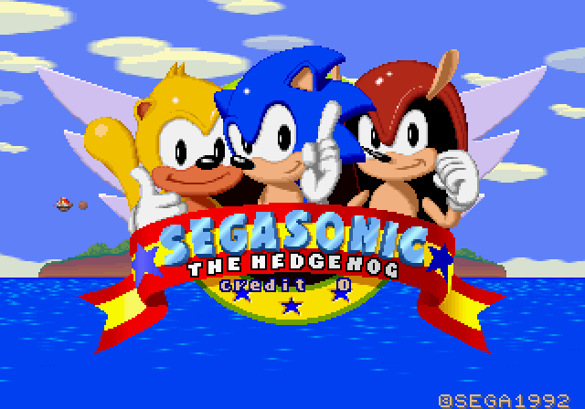
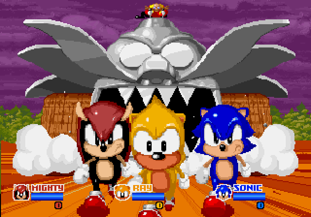
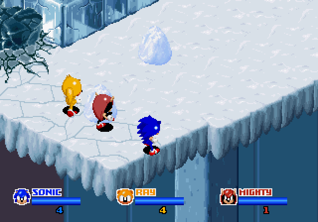
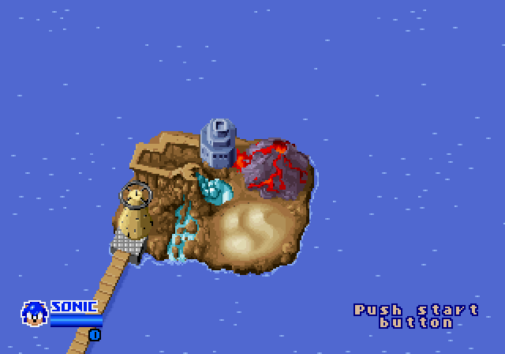
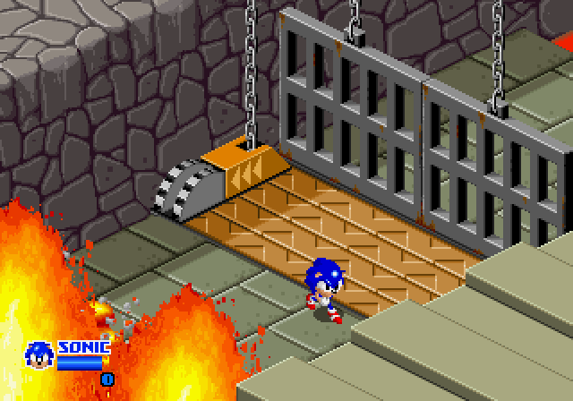
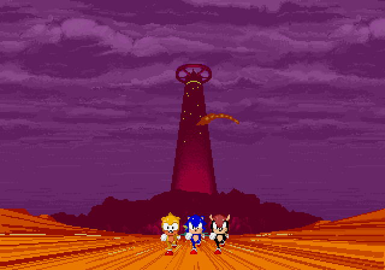

# SegaSonic The Hedgehog — native port

A reconstruction of Sega's 1993 arcade game *SegaSonic The Hedgehog* (Sega System 32) into
platform-agnostic C — not an emulator — with ports to PC, Nintendo Switch and Linux ARM
handhelds (Anbernic RG40XX) on top of it.

**Apart from the screenshots on this page, this repository contains no game data.** The game's program
is here as C, decompiled from the original machine code (`src/`); as with
[n64decomp/sm64](https://github.com/n64decomp/sm64), you bring your own ROM for everything else: the
tools verify it, extract the assets and the data the program reads, and you build your own executable.

<p align="center">
  
  
  
  
  
  
</p>
<p align="center"><sub>Frames drawn by the game's own video library (<code>runtime/src/video.c</code>) while the
decompiled game plays the scenarios of <code>tests/controls/</code>.</sub></p>

## Status

- [x] ROM set verification (MAME set `sonic`, Japan rev. C), by CRC32 and SHA-1 of every file
- [x] NEC V60 disassembler, output identical to MAME's at all 786,432 byte offsets of the program ROM
- [x] Recursive disassembly that follows branch tables, pointer tables and stored code pointers,
      cross-checked against real execution: 541 functions, about 26,000 instructions, no invalid
      or overlapping paths, and every executed address lands on a decoded instruction
- [x] Asset extraction into plain resources: 16 tile sheets and every sprite frame (6,138 of them) as
      indexed PNGs in the colors the game shows them with, showing what the board draws, and 175 PCM
      samples (WAV); the tile and sprite ROMs build back from those PNGs byte for byte
      (`extract_assets.py --check`). The game's data tables join them as their formats are worked out
- [x] System 32 board model in C (`runtime/`): memory map, interrupt controller and timers, I/O chip,
      EEPROM, trackballs, palette and mixer registers, and the FD1149 (317-0213) level-load protection
- [x] Reference run of the original program on MAME's V60 core against that model: boots, shows the
      region warning and runs the attract mode for 10 minutes of game time
- [x] V60 to C translation (the scaffold, `tools/recompile.py`): the game runs as native C, and its
      work RAM, video RAM, sprite RAM, palette and mixer match the reference run at the end of every frame
- [x] Decompiler (`tools/decompile.py`): one C function per original function, with no CPU left in it:
      registers become named parameters, results and typed local variables, the stack and the condition
      flags are gone, branches become `if`/`while`/`do`/`switch` with `||` and `&&`, a jump through a
      table of code becomes a `switch` on the index, and the game's variables, tables, structures
      (objects, players, and each object type's own variables) and the board's registers are read and
      written by name; addresses the code uses as values print as names (`TEXT_CELL(14, 20)`,
      `PALETTE_RAM + 0x83A0u`, `NAME_ADDRESS`). Code two functions share is written once (the player's
      update runs into the state code of its animation, which takes an `entry_point`; each player state
      the update jumps to is a function of its own). The code nothing in the program reaches (about
      12.5 KB: drawing routines, object types never spawned, earlier versions of live routines) is
      decompiled too, so the C holds the whole program. It matches the reference frame by frame in every
      scenario of `tests/controls/`
- [x] Names: every function, variable, table, structure field and board register has one in
      `symbols.txt`, with the evidence for it, and so do the parameters and results of the functions,
      the labels the remaining `goto`s jump to, and what each object type keeps in the object structure
      (`OBJECT(current_object)->fire_front.path`, per family of functions); local variables have the
      names `symbols.txt` gives them by the instructions that write them, or take the name of what they
      hold, the field they were read from or the parameter they are passed as. The original's quirks
      found along the way are noted next to the code they are in
- [x] The game's source: the decompiled C is in `src/`, and the game builds from it
- [x] Code coverage: the static analysis follows the game's object tables described in `symbols.txt`,
      so the C comes from the ROM alone, and it finds all the code the reference runs. The 98 scenarios
      of `tests/controls/` (attract mode, games for one, two and three players, every stage, the ending,
      the test mode, and pokes that reach what the game itself never does) run 98.6% of its instructions;
      `docs/unreachable.txt` says, for each of the other 625, why no scenario runs it (dead code, a
      hardware fault the board model cannot produce, or a rare situation)
- [x] System 32 video library (`runtime/src/video.c`): the four tilemaps (zoom, row scroll and row
      select, clip windows), the text and bitmap layers, the backdrop, the two sprite frame buffers with
      their list processor, and the mixer (priorities, blending, shadows, color offsets). It draws each
      frame from the board's memories into a 320 or 416 x 224 picture, and matches MAME's System 32
      video pixel for pixel in every frame of the scenarios (`check_scenarios.py --video`)
- [x] Sound board model (`runtime/src/sound.c`): the Z80's memory and ports, its interrupt controller,
      the ROM bank, the shared RAM; a reference run of the sound program on MAME's Z80 with ymfm's YM3438
      and MAME's RF5C68 (`s32ref --sound-wav`), and a Z80 disassembler identical to MAME's
- [x] Sound: the Z80 sound driver decompiled into C (`src/sound/`, written by `tools/decompile_sound.py`
      from the sound ROM and `sound_symbols.txt`), running on the board's time, and the YM3438 and RF5C68
      as libraries (`runtime/src/ym3438.c`, `runtime/src/rf5c68.c`) that make the same samples as ymfm and
      MAME. It matches the reference's samples and sound board memories frame by frame in every scenario
      (`check_scenarios.py --sound`). It reads like the game's C: its functions, parameters, local
      variables, variables, structures (the sequence players, the FM and PCM voices, the MIDI parts) and
      the chips' ports are named in `sound_symbols.txt`, with the evidence for each name, and the bytes the
      Z80 keeps apart in a register pair (a count in B, a register number in C) are variables of their own
- [x] PC port (`ports/sdl2/`): the game in a window, with its sound, the mouse, the keyboard and game
      controllers, on SDL2; its settings in `sonic.ini`. Built and played on Windows; SDL2's own packages
      should build it on Linux and macOS (not tried yet)
- [ ] The game built from its assets: every part of the ROM decoded into plain, editable resources in
      `assets/` (sprites as PNG, the data tables and levels in readable form), and the build making the
      game's data from them instead of from the ROM, so that edited assets (a new character, sprites at a
      higher resolution) go into the game
- [ ] Ports, in a repository of their own built on this one (`segasonic-port`), so that this one stays the
      faithful reference: Windows and macOS, Android, Nintendo Switch and Linux ARM handhelds (Anbernic);
      released as downloads with no game data in them (the first run takes the player's own ROM set and
      extracts the assets), and listed in [Quiver Launcher](https://quiverlauncher.com)
- [ ] A console version, there too, in a layer of its own beside the arcade one, which stays as it is: no
      coins, a settings menu in the game's own style, higher resolution

## Getting started

Requirements: Python 3.10 or newer, CMake 3.20 or newer, a C11 / C++17 compiler (Visual Studio Build
Tools on Windows) and, for the game's window, the SDL2 development files: on Windows, unpack
`SDL2-devel-2.x.x-VC.zip` from [SDL's releases](https://github.com/libsdl-org/SDL/releases) into
`build/downloads/sdl2/` (or point `SDL2_DIR` at it); elsewhere, the system's package (`libsdl2-dev`).
Without SDL2 only the headless builds are made.

1. Put your MAME `sonic.zip`, or the files inside it, in `rom/`, and check it:

   ```bash
   python tools/verify_rom.py
   ```

2. Extract the assets into `assets/` (the tile sheets, the sprites and the samples, so far; the game does
   not read them yet), and check that they build back into your ROM byte for byte:

   ```bash
   python extract_assets.py
   ```

   ```bash
   python extract_assets.py --check
   ```

3. Build the game and the development tools into `build/bin/`. The build writes the game's data from your
   ROM set into the executables (`tools/embed_data.py`), so they need no other file to run:

   ```bash
   cmake -S . -B build/cmake
   ```

   ```bash
   cmake --build build/cmake --config Release
   ```

4. Play:

   ```bash
   build/bin/sonic
   ```

   The executable can be copied anywhere with SDL2's library beside it (`SDL2.dll` on Windows, which the
   build puts next to it). It is built from your ROM: it is yours, not one to share.

   Or run the game without a window, here with the controls of a one-player game:

   ```bash
   build/bin/sonic_game_headless --script tests/controls/coin_start.txt
   ```

## Playing

It is the arcade game: put a coin in (5), then start (1). Player 1's controls:

| Control | Keys |
|---|---|
| Trackball | the mouse, or the arrow keys |
| Button | left mouse button, Z or space |
| Coins 1-3, starts 1-3 | 5, 6, 7 and 1, 2, 3 |
| Service, test | 9 and F2 (in the operator's menu, 9 moves the cursor and F2 picks) |
| Full screen | F11 or Alt+Enter |
| Smooth or sharp pixels | F3 |
| The mouse's ball rolls on, or stops with the mouse | F4 |
| The mouse slower, faster | F5, F6 |
| Quit | Escape |

The mouse turns a trackball as the arcade's does: the ball turns with the mouse and, when the mouse stops
or is lifted, rolls on and slows down; the right button holds it. Each game controller is a player: the
left stick is the trackball, A the button, Start the start and Back a coin.

The window's settings are in `sonic.ini`, beside the executable, written with every setting and what it
does the first time the game runs: the mouse's speed and how the ball rolls on, the keys' and the
stick's speed, the window's scale, full screen, smooth pixels and the volume. The game reads the file again
whenever it is saved while the game runs, and the keys above write what they change into it. The game's own
settings and bookkeeping (the EEPROM) are kept in `sonic.eeprom`, beside the executable too.

### Changing the decompilation

`src/` is written by the decompiler from your ROM and `symbols.txt`. After changing either of them, or
the decompiler, write it again and check it:

```bash
python tools/decompile.py
```

`src/sound/` is written the same way from the sound ROM and `sound_symbols.txt`:

```bash
python tools/decompile_sound.py
```

`build/bin/s32ref` runs the original program on MAME's V60 core against the same board model. Both
it and the game take the control scripts of `tests/controls/` (format in
`runtime/include/s32/script.h`), and both write a hash of the board state after every frame. This runs
every script on both, compares them frame by frame and checks that the static analysis alone found all
the code the reference executed; `--video` and `--sound` compare every frame's picture and sound too,
and `--jobs N` runs N scripts at a time:

```bash
python tools/check_scenarios.py
```

`python tools/decompile.py --check` reports what the analysis found (functions, parameters and results,
the registers code reached through memory slots or interrupts would hand back), and `--trace` makes
every function report itself when it runs (`--out DIR` writes such a copy elsewhere; CMake builds it
with `-DSONIC_DECOMPILED_DIR=DIR`). `build/decompile/index.txt` lists every function with where its C is,
its callers and callees, what it mentions, and how much of it the scenarios ran. `--variables FILE` lists
every local variable with the instructions that write it, which is what `symbols.txt`'s `local` lines
name them by, and `--split-webs` writes the C with every value of a register as a variable of its own,
to name them.

Other tools:

- `tools/disassemble.py` writes the listing, `build/listing/sonic.s`, with a report beside it.
- `tools/recompile.py` writes the translation scaffold the decompiler grew from (one C statement per
  instruction) into `build/generated/`; CMake builds it with `-DSEGASONIC_SCAFFOLD=ON`, and
  `check_scenarios.py --translated` checks it.
- `tools/coverage.py` classifies every byte of the program ROM and lists what is still unexplained.
- `tools/make_walks.py` writes the per-stage scripts.
- `tools/reference/compare_with_mame.py` checks our disassembler against MAME's.
- `s32ref --watch ADDRESS` prints a byte whenever it changes.
- `s32ref --dump-frame N --dump-dir DIR` saves the board state at a frame, and
  `tools/render_state.py DIR` draws its text layer and tilemap pages.
- `s32ref --video-hashes FILE` and `--video-dump N --video-dir DIR` draw every frame with MAME's System
  32 video (the hash of each frame, frames as BMP); `sonic_game_headless` takes the same options and draws
  them with the game's own video. `check_scenarios.py --video` compares the two in every scenario.
- `s32ref --sound-hashes FILE`, `--sound-log FILE` and `--sound-wav FILE` run the sound board too, on
  MAME's Z80 and RF5C68 and ymfm's YM3438: per frame, a hash of the samples and of the sound board's
  memories; every write to the sound chips; everything mixed into a WAV file.
- `tools/z80/disassembler.py` decodes the sound program; `tools/reference/compare_z80_with_mame.py`
  checks it against MAME's Z80 disassembler at every byte.

## Layout

```
rom/                    your ROM (ignored by git)
assets.json             asset manifest: positions and formats, no data
extract_assets.py       extracts assets/ from your ROM, and checks they build back into it (--check)
sprite_palettes.json    where in the program ROM each sprite frame's palette is (positions only)
tile_palettes.json      the same for each tile
src/                    the game's C, decompiled from the program (tools/decompile.py writes it)
src/sound/              the sound driver's C, decompiled from the sound program
                        (tools/decompile_sound.py writes it)
symbols.txt             names of functions, data, variables, board registers, structures and fields,
                        parameters and local variables, what pointers point at, and the layout of the
                        tables that hold code addresses (names only, no data); its comments explain how
                        each part of the game works
sound_symbols.txt       the same for the sound program
runtime/                System 32 board model (memory map, interrupts, I/O, the sound board), the video
                        library, the YM3438 and RF5C68 libraries, and what the decompiled game and sound
                        driver use besides memory (src/game.c, src/sound_cpu.c, include/game/support.h,
                        include/sound/support.h), in C; part of the game
ports/headless/         runs the game with no screen or sound, for comparisons
ports/sdl2/             the game in a window, on SDL2: picture, sound, controls, settings (sonic.ini)
tests/controls/         control scripts: coins, buttons, trackball moves and pokes per frame
docs/unreachable.txt    the code no scenario runs, and why
tools/sonic_rom.py      ROM set definition and memory region layouts
tools/embed_data.py     writes the game's data from your ROM set as C, for the executables to carry
tools/asset_formats.py  the board's data formats to standard files (PNG, WAV) and back
tools/palette_census.py runs the scenarios with the sprite and tile censuses on (sonic_game_headless
                        --sprite-census, --tile-census) and finds each frame's and tile's palette in the
                        program ROM: writes sprite_palettes.json and tile_palettes.json
tools/v60/              NEC V60 instruction decoder and C translation of each instruction
tools/z80/              Zilog Z80 instruction decoder, analysis, lifting and timing (the sound program)
tools/disassemble.py    recursive disassembler, listing and analysis report
tools/coverage.py       byte map of the program ROM: code, data, fill and what is still unknown
tools/recompile.py      splits the program into functions; translates them to C (the scaffold)
tools/decompile.py      decompiles the program into readable C (tools/decompiler/: lifting to IR,
                        stack, data flow and signatures, conditions, expressions, structure, memory
                        and pointer types, variables, the C printer)
tools/decompile_sound.py  decompiles the sound program with the same decompiler, set up for the Z80
tools/check_scenarios.py  runs the control scripts on the reference and on the decompiled game
tools/reference/        MAME's V60 and Z80 cores and disassemblers, its System 32 video and RF5C68, and
                        ymfm's YM3438, built only into the reference tools (s32ref, the oracles), over
                        stand-ins for the parts of MAME they need
assets/, build/         generated on your machine (ignored by git)
```

## Reading the C

The game's C lives in `src/`: `game.h` (prototypes), `ram.h` (the game's variables, tables, board
registers and structures), `game_NN.c` (the functions, in the order of their V60 addresses) and `table.c`
(the code the program reaches through memory slots, by address). What it uses besides memory is in
`runtime/include/game/support.h`.

- **Memory.** The game's variables are lvalues over the work RAM (`stage`, `scroll_position`), its tables
  read-only arrays over the program ROM (`stage_camera_origins_x[stage]`), and its two structures,
  `struct object` and `struct player`, are reached with `OBJECT(address)` and `PLAYER(address)`: the game
  keeps 24-bit addresses in its variables, as the original does. Each object type's own variables are a
  view of the object (`OBJECT(current_object)->tornado.path`) where the code shows which type the object
  is (its own object, or one it gives a handler); elsewhere (a child, the object a touch reports) those
  bytes keep their generic names (`var_80`). What the code reads through a pointer it
  computes goes through the board's bus: `mem_read16(p)`, `mem_write8(io_cnt, x)` (the board registers
  are addresses), `ROM16(p)` for the program ROM. `AS8(x)` and `AT8(x, 1)` are the low byte and the second
  byte of `x`, where the code reads a part of a variable or field.
- **Links.** The game links its objects by the low half of their addresses: `LINKED(current_object,
  OBJECT(current_object)->child)` is the object `child` names, in the work RAM page.
- **Registers.** `current_object`, `object_cursor`, `current_player`... are the registers the whole program
  keeps (R20, R23, R18): global variables. Everything else a function keeps in registers is a local
  variable or a parameter. A parameter or local still named after its register (`r1`, `p_r4`, `r0_2`)
  holds what that register held in the original where the meaning changes with the caller: a value one
  routine leaves in a register and another one, several calls further on, reads (`run_sega_logo` relies on
  `init_sprites` leaving 0xFFFF in R0). The C passes those values along explicitly so that it does what the
  original does; a register the original reads before anything sets it starts at 0.
- **Results.** A function hands back one value as its return value, and more through pointers
  (`uint32_t *p_depth`); a caller's variable goes in and comes out.
- **Control flow.** Loops, `if`, `switch` (a jump through a table of code is a `switch` on the index) and
  `return` come from the original's branches. A `goto` remains where the original jumps into code already
  written elsewhere (a state that goes on in another state's code); its label is named in `symbols.txt`.
  `default: unknown_code(address)` is where a jump table's index would leave the table: the original
  checks nothing and would jump into whatever follows it.
- **Interrupts and the frame.** `frame_wait()` is where the game waits for the next frame and the board
  runs its events, and `take_interrupts()` where the interrupts that raised are handled; the interrupt
  handlers are ordinary functions. `halt()` (only in `int_default` and `int_vector_02`) does nothing, as in
  MAME.
- **Unused code.** The functions nothing in the program reaches are in the C beside the rest, in their
  place by address; their entries in `symbols.txt` (at the end) start with "unused:" and say what each one
  would do. With no caller to say what they take and hand back, they take every register they read before
  writing it, and hand back what `symbols.txt` says (`result` lines). The 00 bytes that align the routine
  after them are data, not code. A few of them use addresses of their own stack frame as values: there the V60's stack
  pointer is a global variable, `stack_pointer`, and the stack stays in work RAM, as on the board. An
  instruction the V60 would refuse (a bit operand in a register) is `invalid_operand(address)`, which
  stops the game, as MAME does.
- **The sound driver.** `src/sound/` is the Z80 program the same way. The sound chips are read and
  written through `port_in`/`port_out` by the ports' names; its variables are names over the sound RAM
  (`sound.h`), its structures are reached with `FM_VOICE(voice)->`, `SAMPLE_VOICE(voice)->`,
  `MIDI_PART(part)->`, and what it reads through an address it computes goes through the board's bus
  (`z80_read8`, `z80_write8`); `z80_block(cycles)` opens each
  stretch of code with the time it takes, so the chips' timers, the interrupt and the samples happen when
  they did on the board.

## How the port works

- **Game code.** The V60 machine code is decompiled to C (`src/`), so the game runs natively with no CPU
  emulation. The program reads its data tables and level data, and the video and sound chips their
  graphics and samples, from the ROM regions the build writes from your ROM set into the executable
  (`runtime/include/game/data.h`), as the original reads them from its ROM chips. As each part of the ROM
  is decoded into `assets/`, the build makes that part from the assets instead.
- **Video.** The System 32 video hardware is a library (`runtime/src/video.c`) that draws every frame
  from the board's memories, as the board does, into a 320 or 416 x 224 picture; a platform shows that
  picture as a texture, scaled and filtered as it likes.
- **Sound.** The Z80 sound driver went through the same decompilation (`src/sound/`); the YM3438 and
  RF5C68 chips are libraries that make the samples a platform plays.
- **Platforms.** Each port only provides a window, input, audio output and the presentation of the
  picture, through the board's hooks (`runtime/include/s32/machine.h`); `ports/sdl2/` is the first.

## Legal

- This project is licensed under the BSD 3-Clause License; see `LICENSE`.
- The C in `src/` is the game's program decompiled into a new form: logic only, with names and
  comments written for this project. No ROM contents (graphics, sound, data tables, level data) and no
  extracted assets are distributed by this project; they come from your own ROM. The screenshots in
  `docs/screenshots/` show the game running from this code.
- `runtime/`, `tools/v60/disassembler.py` and `tools/z80/disassembler.py` follow the behavior of MAME
  source files and, for the YM3438, of ymfm, and `tools/reference/mame/` holds copies of MAME files. Those are BSD-3-Clause; see
  `tools/reference/mame/LICENSE`. `tools/reference/ymfm/` holds a copy of ymfm (BSD-3-Clause; see its
  `LICENSE`).
- SegaSonic The Hedgehog is a trademark of SEGA. This project is not affiliated with or endorsed by SEGA.
